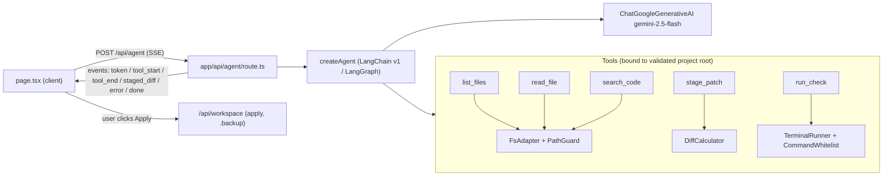

# AETHER — LangChain Tool-Using Agent (Design)

**Date:** 2026-11-02
**Status:** Draft, awaiting approval
**Approach picked:** B, a tool-using agent (picked by the user)

## 1. Intent

AETHER's AI layer today is one Gemini call. The user attaches files by hand, the
model replies with tagged code blocks, and the client turns those into staged diffs.
The user wants AETHER to be a proper product, built on LangChain. In practice that
means the AI explores the project, reads what it needs, proposes changes and checks
its own work. The user stays in control of every change that gets written to disk.

AETHER is for personal use and runs **on the user's own machine only**
(`npm run dev` / `npm start`). There will be no Vercel deployment.

## 2. Goals, Non-goals, Anti-goals

**Goals**
- Replace `GeminiClient` (raw `@google/genai`) with a LangChain agent that runs on Gemini through `@langchain/google-genai`.
- Give the agent safe tools: `list_files`, `read_file`, `search_code`, `stage_patch`, `run_check`.
- Stream the agent's progress to the UI: text tokens, each tool call and its result, and staged diffs.
- Keep the existing UI, diff review, terminal drawer, `PathGuard`, `CommandWhitelist`, `SecretVault` and `Sanitizer`.
- Keep working within the Gemini free tier (15 RPM).

**Non-goals**
- Vercel or any cloud deployment.
- RAG, embeddings or a vector store (Approach C).
- Persistent memory across browser sessions. History stays client-side, as it is today.
- Supporting more than one model provider.

**Anti-goals** (count as failure even if the feature technically works)
- The agent writes to disk without the user clicking Apply.
- An API key or a secret from the project appears in model input, in the UI or in logs.
- The agent loops and burns the free-tier quota on a single question.
- The agent touches anything outside the selected project root.

## 3. Approaches considered

| | Approach | Trade-off | Decision |
|---|---|---|---|
| A | Swap the SDK for `ChatGoogleGenerativeAI`, with the same behaviour as today | Lowest risk, but little real gain | Rejected |
| **B** | **Tool-using agent with stage-only writes** | **Real "AI engineer" behaviour. Uses 3–6 model calls per request** | **Picked** |
| C | B plus a RAG index of the codebase | More quota and more complexity than personal-size projects need | Rejected |

## 4. Architecture

### New server-only module: `src/lib/agent/`
| File | Responsibility |
|---|---|
| `model.ts` | Builds `ChatGoogleGenerativeAI` (`gemini-2.5-flash`, temperature 0.2, `maxRetries` 2). Owns the shared 15 RPM limiter. |
| `rate-limiter.ts` | Sliding-window limiter, moved out of today's `GeminiClient.throttle`. |
| `tools/*.ts` | One file per tool. Each factory takes a validated `canonicalRoot` and returns a LangChain `tool()` with a Zod schema. |
| `agent.ts` | `createAetherAgent(root, mode)` returns the agent with the system prompt, the tools and a step limit. |
| `events.ts` | Typed SSE event union, shared with the client through `import type`. |
| `system-prompt.ts` | Adapts today's `PromptBuilder` (modes and the untrusted-data policy). Adds instructions on using the tools. |

### Tools
| Tool | Input | Behaviour | Limits |
|---|---|---|---|
| `list_files` | `{ dir?: string }` | Tree under root, reusing `FsAdapter.listTree` (it already skips `node_modules`, `.git`, `.next` and so on) | ≤ 500 entries |
| `read_file` | `{ path: string }` | `FsAdapter.readFile`, then `SecretVault.redactSecrets`, then `Sanitizer.wrapUntrustedContext` | ≤ 100 KB. Refuses `.env*` |
| `search_code` | `{ query: string, glob?: string }` | Plain-text, case-insensitive search across text files | ≤ 50 matches, ≤ 200 chars per line |
| `stage_patch` | `{ path: string, content: string }` | Validates the path with `PathGuard`, computes the diff with `DiffCalculator` and emits a `staged_diff` event. **Never writes to disk** | ≤ 10 patches per request |
| `run_check` | `{ check: "test" \| "lint" \| "typecheck" \| "git_status" \| "git_diff" }` | Maps to a fixed command and runs it through `TerminalRunner` | 30 s timeout. Output is redacted and truncated to 8 KB for the model |

### Streaming protocol (`/api/agent`)
SSE lines in the form `data: <json>`, using one of these event types:
`token{text}`, `tool_start{id,name,input}`, `tool_end{id,name,ok,summary}`,
`staged_diff{diff: StagedDiff}`, `error{message}` and `done{}`.
The route uses the agent's `streamEvents` / `stream` API. The client stops parsing
tagged code blocks for staging, because `stage_patch` is now the only path for
proposing changes. `StreamParser` stays in use for `<thinking>` / `<plan>`.

### UI changes (minimal)
- `page.tsx` sends `{ messages, mode, attachedFiles, root }` to `/api/agent` and handles the new events.
- New component: `components/chat/tool-activity.tsx`. Inside the assistant message it shows a compact timeline, for example "📂 read_file app/page.tsx ✓".
- `staged_diff` events call `addStagedDiff`, as today. The Apply flow does not change.
- Manual attachments still work. They are added as extra context.

### Chat history (added by user request)
- Conversations are stored **on disk**, as one JSON file per conversation under `data/conversations/` (gitignored, never sent anywhere). They survive browser clears and restarts.
- Each record holds: `id`, `title`, `projectRoot`, `mode`, `createdAt`, `updatedAt`, `messages[]` (text, thinking, plan, tool activity, and the staged diffs with their accept/reject status).
- Title: the first ~60 chars of the first user message. No extra model call, to save quota. Can be renamed.
- New API: `app/api/conversations/route.ts` (list, create) and `app/api/conversations/[id]/route.ts` (get, update, rename, delete). IDs are validated as UUIDs, so they can never be used as paths.
- UI: a left sidebar lists conversations grouped as Today, Yesterday and Older, with search, a "New chat" button, rename and delete (delete asks first).
- To stay within the free tier, only the last 20 messages of a conversation are sent to the model. The full history stays on disk.

### Confirm-before-save with explanations (added by user request)
- `stage_patch` takes a required `reason` field: one or two plain sentences on why this file is being created or changed.
- When the agent finishes, a **Review & Save** dialog opens. It lists every proposed file with:
  - a **New** or **Modified** badge, plus lines added and removed
  - the agent's `reason`, shown next to the file
  - an expandable side-by-side diff
  - a checkbox per file (all checked by default)
- Buttons: **Save selected**, **Discard all** and **Ask AI to revise** (sends feedback back into the chat).
- Nothing is written until the user clicks Save. Saving goes through the existing `/api/workspace` apply path, which creates a `.backup` before each overwrite. Then a toast shows "3 files saved" with each path listed.
- The decision (saved or discarded, per file) is recorded in the chat history.

### Visual redesign (added by user request)
The user finds the current dark Obsidian design unappealing. Direction: a **light theme**
with soft gradients, strong text contrast (WCAG AA) and a friendlier, more
approachable layout. Exact palette and layout to be agreed through mockups before
it is built. See §9.

## 5. Security and limits
- Each tool is a **closure over a root that `PathGuard.validateRoot` already accepted**. The model can never pick the root, and every path it passes goes through `PathGuard.validatePath`.
- Tool output is treated as untrusted data and wrapped by `Sanitizer`. The system prompt keeps the anti-injection policy.
- Agent step limit: **8 model turns per request** (recursion limit). After that it stops and reports what it has.
- `req.signal` is passed to the agent, so the Stop button cancels in-flight model calls and running checks.
- No secrets in the client. `GOOGLE_API_KEY` is read only in `model.ts`.
- The old `/api/chat` route and `GeminiClient` are removed once `/api/agent` works. The `@google/genai` dependency is dropped.

## 6. Testing
- Unit tests for each tool against a temp directory fixture: path escape, `.env` refusal, size caps, redaction, `stage_patch` never writing to disk.
- Agent loop test with LangChain's fake tool-calling chat model: a scripted tool call → tool result → final answer produces the expected SSE event sequence.
- The existing security, pentest, terminal and workspace suites must still pass.
- Manual check: `npm run build` passes (strict TS), and a real Gemini run asked "add a health-check API route" reads files, stages a diff and passes `run_check test`.

## 7. Calls made by the builder (user may override)
- Use LangChain v1 `createAgent` (built on LangGraph) instead of a hand-written graph. It is simpler, and the 8-step limit is enough.
- `run_check` runs automatically **without** per-call confirmation, because it is limited to 5 fixed read-only commands. Any write still needs Apply.
- Model `gemini-2.5-flash` stays the default and can be overridden with `AETHER_MODEL` in `.env.local`.
- The tool-activity UI is compact, following the existing Obsidian styling.

- Chat history lives in local JSON files rather than SQLite or localStorage. It needs no new dependency and survives browser clears.

## 9. Visual design (decided with the user)
Reference mockup: `.superpowers/brainstorm/aether-sunrise-v2.html` (user approved).

- **Theme: "Sunrise" (light).** Background gradient `#fff7ed → #fef2f2 → #f5f3ff`. Brand gradient `#f97316 → #e11d48 → #7c3aed`. Ink `#1c1917`, muted `#78716c`, lines `#efe3d6`. Text contrast meets WCAG AA.
- **Logo: "Prism" (concept B).** Two gradient planes (orange→rose on the left, rose→violet on the right) lean together to form an A, with the counter cut out as negative space. It is built as an inline SVG React component `<AetherLogo />` and also exported as `public/logo.svg`, `app/icon.svg` (favicon) and PWA icons. The wordmark "AETHER" is set in Inter 800 with wide tracking.
- **No emoji anywhere in the UI.** Icons come from `lucide-react` (already installed), at a consistent 16 px with a 1.9 stroke.
- **Humanized copy.** Tool activity reads as a "Work log" in plain sentences ("Read `lib/db.ts` to find your Prisma client"), not raw tool names. Empty states and errors are written the way a colleague would say them.
- **Layout:** left sidebar (logo, New chat with `Ctrl N`, search, history grouped by date, current project), centre chat (title, model, mode switcher, messages, composer with Attach and Paste error), right panel (Files / Changes tabs and a terminal card).
- **Review changes dialog:** gradient top rule, a total `+/−` count, and per file a checkbox, path, NEW/EDITED tag, the reason, and an expandable diff. Buttons: Discard, Ask for changes and Save N files.
- Fonts: Inter (UI) and JetBrains Mono (code), loaded through `next/font`.

## 8. Left to the builder
Exact file splits within the 250–350 line cap, Zod schema wording, event-batching
details and test fixture layout.
